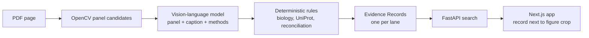

# HiveBlot

Lane-level, source-linked evidence extraction from Western blot figures.

[](https://github.com/nikhilesh-s/hive/actions/workflows/experimental-ci.yml)
[](LICENSE)
[](https://doi.org/10.5281/zenodo.23491677)
[](https://doi.org/10.5281/zenodo.23524346)

HiveBlot reads a Western blot figure together with its caption and the paper's
methods, and turns it into lane-level **Evidence Records**. Every field in a
record (target, modification, antibody, cell line, treatment, band state) has
its own status and the verbatim source wording it came from, so a researcher
can check a value against the paper. When the figure and the text disagree,
HiveBlot flags the conflict and leaves the value empty instead of choosing one.

Live beta: <https://hiveblot-beta.vercel.app>

## Results

Pre-registered blind benchmark on 3 unseen open-access papers, scored against
labels a teammate made from the PDFs without seeing HiveBlot's output.
Protocol, annotations, scoring code and results are in
[`eval/blind_2026_10/`](eval/blind_2026_10/) and archived at
[10.5281/zenodo.23524346](https://doi.org/10.5281/zenodo.23524346).

| Measure | Result |
|---|---|
| Correctness | 512 of the 553 values HiveBlot extracted were correct (92%, counting annotator-confirmed notation fixes). Scored strictly as pre-registered: 78% (222 of 285) |
| Coverage | 57% of the labeled values (512 of 895) |
| Time, before review | About 6x faster than hand labeling (19.8 vs 123.5 min) |

The time comparison is HiveBlot's whole run on the 3 papers against the
annotator's logged time on the 8 panels she labeled. It does not include the
time a researcher would spend reviewing the output.

## Limitations

- **Coverage is 57%.** HiveBlot leaves many values empty, so a researcher still
  has to review the output and fill the gaps.
- **Small test.** 3 papers and one annotator, who is a team member. This is not
  an independent evaluation or a literature-wide accuracy figure.
- **Notation fixes.** The 92% counts notation differences the annotator
  confirmed as equivalent. Scored strictly as pre-registered, before those
  fixes, the figure is 78%. See `eval/blind_2026_10/report/RESULTS.md`.
- **Beta.** Interfaces may change. The hosted beta holds 3 papers, not a literature-wide index.
- **Densitometry is experimental.** It is tested on synthetic images only, is
  kept out of Evidence Records, and is a reading aid, not a quantification.
- **Figure crops** are not MIT-licensed; see [`THIRD_PARTY_NOTICE.md`](THIRD_PARTY_NOTICE.md).

## How it works



1. **Panels and model.** OpenCV finds candidate panels
   (`western_blot_miner/pdf_preprocess.py`); a configurable vision-language
   model reads each with its caption and methods and proposes what it shows.
2. **Deterministic rules.** Plain code, not the model, decides modification,
   phosphosite, experiment type, loading control and protein identity (UniProt
   lookup), and reconciles competing sources by an evidence hierarchy
   (`biology.py`, `resolve.py`, `reconcile.py`).
3. **Evidence Records.** One record per lane. Each field is `SUPPORTED`,
   `AMBIGUOUS`, `CONFLICTING` or `MISSING`, with the verbatim source text. A
   `CONFLICTING` field has `value = null` and keeps the competing candidates
   (`evidence_record.py`).

Biology rules enforced in code and tests: phosphorylation is never inferred
from a name prefix such as `p-ERK`; expected and observed molecular weight are
separate fields; band presence is not densitometry; experiment type comes from
methods and caption text, not from how the image looks.

## Repository layout

| Path | Contents |
|---|---|
| `western_blot_miner/` | Extraction engine, biology rules, Evidence Record schema, tests |
| `api/` | FastAPI search service (SQL-guarded, read-only DB role) and tests |
| `web/` | Next.js frontend |
| `eval/` | Blind benchmark (`blind_2026_10/`), seed scorer, worked examples |
| `migrations/`, `supabase/`, `scripts/` | Postgres schema, local database and seeding scripts |
| `research/`, `docs/internal/` | Protocols, QA reviews, deployment and ops notes |

## Quick start (local, no cloud credentials)

```bash
python3.12 -m venv .venv
.venv/bin/pip install -r requirements-local.txt
.venv/bin/python scripts/local_db.py up                       # embedded Postgres
.venv/bin/python scripts/local_db.py load eval/demo/*/supabase_rows.json

cp api/.env.example api/.env     # fill DB URLs from `local_db.py status`
cd api && ../.venv/bin/uvicorn app.main:app --reload

cp web/.env.example web/.env     # API_BASE_URL=http://localhost:8000
cd web && npm install && npm run dev
```

Tests and the offline seed benchmark:

```bash
python3 western_blot_miner/tests/test_biology.py   # and the other tests in that folder
python3 eval/score.py
cd api && ../.venv/bin/python -m pytest
```

Extracting from your own PDF needs a model backend; see `western_blot_miner/README.md`.

## How to cite

Cite the software via
[10.5281/zenodo.23491677](https://doi.org/10.5281/zenodo.23491677) and the
benchmark via
[10.5281/zenodo.23524346](https://doi.org/10.5281/zenodo.23524346). GitHub's
"Cite this repository" button reads [`CITATION.cff`](CITATION.cff).

## License

Source code and documentation are released under the [MIT License](LICENSE).
